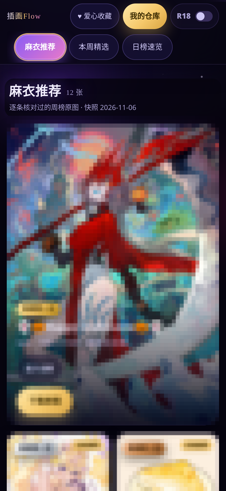

# Illustration Flow — a personal illustration gallery with a lossless vault

## 中文说明

无损插画流的实现方法开源版：双列瀑布画廊 + 原图字节级无损的个人仓库。

- 实现文档：[`docs/IMPLEMENTATION.md`](docs/IMPLEMENTATION.md)（双列确定性分发、无损仓库与哈希校验导入、多源过滤推荐流、分区高亮）
- 参考代码：[`reference/`](reference/)（双列布局、SHA-256 校验导入、多源合并与硬过滤；`npm install && npm run typecheck` 可直接验）
- 本仓只有机制与脱敏说明；真实图片与个人数据不在本仓（存放在私有存档仓）

## 效果图 / Screenshots

运行中界面的实拍（2026-11-09）；插画图面已作薄码处理，只保留版式与色调：

A sectioned masonry gallery fed by Pixiv ranking boards, with a private
vault ("warehouse") for the owner's own illustrations. The defining
constraint: **originals are stored and served byte-for-byte** — no
recompression, no transcoding, ever. Grid previews are a separate tier
and never touch the original bytes.

This repository open-sources the **implementation method**. The owner's
images and personal data live in a private archive; nothing here
contains gallery content.

## What it does

- Sections: curator picks → weekly chart → daily chart → an opt-in
  adult zone (fully hidden when off, including in favorites) →
  favorites as their own page.
- Warehouse: upload or collect any gallery work into the vault with
  the same treatment as uploads — view, per-image download, ZIP pack,
  dedupe on re-add.
- Viewer: single image, fit-to-screen, preview first and the original
  swapped in seamlessly. (Illustrations are not manga: no zoom, no
  on-screen pager buttons.)

## Implementation notes

See [`docs/IMPLEMENTATION.md`](docs/IMPLEMENTATION.md) for:

- why the masonry is two explicit column containers, not CSS columns;
- the lossless storage tiers and the hash-verified server-side import
  pattern for large files;
- the ranking pipeline (snapshot fallback, single-image filtering);
- the adult zone's multi-source merged pool with hard filters and
  honest labelling of machine-searched vs human-verified picks;
- the iOS WebView download failure (synthetic clicks lose the user
  gesture) and the full-screen save-page workaround;
- the top-bar rules: fixed-size controls, no counters in the bar, and
  scroll-position-based section highlighting instead of frame
  callbacks.

## Reference code

The [`reference/`](reference/) folder contains a reference
implementation of the core mechanisms, written from the documented
method (the production app runs on a hosted platform whose source is
not exportable).
