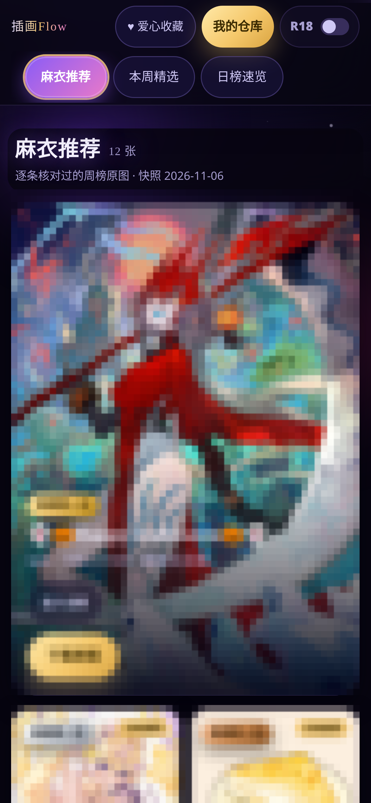

[English](README.md) | **简体中文**

# 插画Flow — 带无损仓库的个人插画画廊

无损插画流的实现方法开源版：双列瀑布画廊 + 原图字节级无损的个人仓库。

- 实现文档：[`docs/IMPLEMENTATION.md`](docs/IMPLEMENTATION.md)（双列确定性分发、无损仓库与哈希校验导入、多源过滤推荐流、分区高亮）
- 参考代码：[`reference/`](reference/)（双列布局、SHA-256 校验导入、多源合并与硬过滤；`npm install && npm run typecheck` 可直接验）
- 本仓只有机制与脱敏说明；真实图片与个人数据不在本仓（存放在私有存档仓）

## 效果图

运行中界面的实拍（2026-11-09）；插画图面已作薄码处理，只保留版式与色调：

一个按分区组织的瀑布流画廊，数据来自 Pixiv 排行榜；另有一个私人仓库，收所有者自己的插画。定义性的约束：**原图字节级存取**——不重压缩、不转码，永远不。网格预览是独立的一层，永远不碰原图字节。

本仓开源的是**实现方法**。所有者的图片与个人数据存放在私有存档仓；本仓不含任何画廊内容。

## 功能

- 分区：策展精选 → 周榜 → 日榜 → 可开关的成人区（关闭时彻底隐藏，收藏里也不例外）→ 收藏独立成页。
- 仓库：上传、或把画廊里任意作品收藏进仓，待遇与自传图相同——查看、逐张下载、打包 ZIP、重复收藏自动去重。
- 看图器：单图、适配屏幕，先出预览再无缝换上原图。（插画不是漫画：没有缩放，没有屏幕翻页按钮。）

## 实现要点

详见 [`docs/IMPLEMENTATION.md`](docs/IMPLEMENTATION.md)：

- 为什么瀑布流是两个显式的列容器，而不是 CSS columns；
- 无损存储的分层，以及大文件经服务端导入时的哈希校验模式；
- 榜单管线（快照回退、单图过滤）；
- 成人区的多源合并池：硬过滤，外加机器搜索与人工核验的如实标注；
- iOS WebView 的下载失败（合成点击会丢失用户手势）与全屏保存页的绕法；
- 顶栏规矩：控件固定尺寸、栏里不放计数、用滚动位置判断分区高亮而不靠帧回调。

## 参考代码

[`reference/`](reference/) 里是按文档方法复写的核心机制参考实现（生产应用运行在源码不可导出的托管平台上）。
